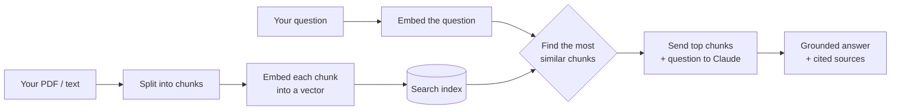

# ragdoc 📄🔍

[](https://github.com/civang/ragdoc/actions/workflows/evals.yml)

**Chat with your documents.** Ask questions about a PDF or text file and get answers grounded in its actual contents — with the source passages shown so you can verify every answer.

Built from scratch in 7 small steps to learn how **RAG (Retrieval-Augmented Generation)** — the technique behind "chat with your docs" products — actually works under the hood. No frameworks hiding the magic: every piece (chunking, embeddings, semantic search, retrieval) is plain, readable Python.

---

## What it looks like

```
$ py ask.py handbook.pdf

Building search index for: handbook.pdf
Indexed 214 chunks. Ask away! Type 'exit' to quit.

You: How many vacation days do new employees get?

ragdoc: New employees receive 15 paid vacation days in their first year,
increasing to 20 days after two years of service (Chunk 2).

  Sources (retrieved passages):
    [Chunk 2 | similarity 0.612] Full-time employees accrue 15 days of paid
    vacation in year one. After two years of continuous service this increases...
    [Chunk 7 | similarity 0.341] Time-off requests must be submitted at least...
```

The answer comes with **receipts** — the exact passages it was based on.

---

## How it works

RAG solves a simple problem: language models don't know the contents of *your* documents, and you can't paste a 500-page manual into every question. So instead of sending the whole document, ragdoc finds just the few passages relevant to your question and sends those.



1. **Chunk** — split the document into small overlapping passages (`chunk.py`)
2. **Embed** — turn each chunk into a vector that captures its *meaning* (`embed.py`)
3. **Search** — embed the question and find the closest chunks by cosine similarity (`search.py`)
4. **Answer** — send only those chunks to Claude, which answers and cites them (`ask.py`)

---

## Quick start

```bash
# 1. Install dependencies
py -m pip install -r requirements.txt

# 2. Set your Anthropic API key (get one at console.anthropic.com)
$env:ANTHROPIC_API_KEY = "sk-ant-your-key-here"

# 3. Chat with a document...
py ask.py path/to/your/document.pdf

# ...or with a whole folder of them at once
py ask.py path/to/your/docs/
```

Supports `.pdf`, `.txt`, and `.md`. Type `exit` to quit.

Point it at a folder and every supported file is indexed into one searchable
collection — ask a question and ragdoc finds the right passage *and tells you
which document it came from*.

### Prefer a browser?

```bash
py web.py path/to/your/docs/
```

Then open **http://localhost:5000** — same pipeline, same cited sources, in a
clean chat UI that adapts to light and dark mode.

> **Tip:** To test cheaply while experimenting, set `MODEL = "claude-haiku-4-5"` in `ask.py`.

The embedding model runs **locally** (via [model2vec](https://github.com/MinishLab/model2vec)) — no second API key, and it works offline after a one-time ~30 MB download.

---

## Project structure

Each file is one step of the pipeline and can be run on its own to see what it does:

| File | What it does | Run it standalone |
|------|-------------|-------------------|
| `chunk.py` | Split a document into overlapping chunks | `py chunk.py <file>` |
| `embed.py` | Turn chunks into meaning-vectors | `py embed.py <file>` |
| `search.py` | Find the chunks most relevant to a question | `py search.py <file>` |
| `ask.py` | **The full RAG app** — retrieve, answer, cite | `py ask.py <file>` |
| `ragdoc.py` | Day-1 baseline: sends the *whole* doc each time | `py ragdoc.py <file>` |
| `evals.py` | Measure retrieval quality (Hit@1, Hit@3, MRR) | `py evals.py` |
| `web.py` | Browser UI for the same pipeline | `py web.py <file-or-folder>` |

`ask.py` vs `ragdoc.py` is a nice before/after: the baseline sends the entire document every time (simple, but doesn't scale); the real app sends only what's relevant (cheap, fast, works on huge docs).

---

## Built in 7 days, one step at a time

| Day | Step | Skill |
|-----|------|-------|
| 1 | Chat with a whole document | LLM + prompting |
| 2 | Split documents into overlapping chunks | text chunking |
| 3 | Embed chunks into vectors | embeddings |
| 4 | Semantic search over chunks | similarity search |
| 5 | Retrieve-then-answer (real RAG) | retrieval |
| 6 | Show the source behind every answer | grounding / citations |
| 7 | Polish, document, ship | 🎉 |

See the [commit history](../../commits) — each day is one focused commit.

---

## Evaluation

"It seems to work" isn't a metric. `evals.py` measures whether retrieval actually
surfaces the right document, so changes to chunk size, the embedding model, or
`top_k` can be judged by a number instead of a vibe.

```bash
py evals.py
```

```
RESULTS
  Hit@1 : 100%   (correct doc ranked first)
  Hit@3 : 100%   (correct doc in top 3)
  MRR   : 1.000  (1.0 is perfect)

  Gate: Hit@1 >= 80% ... PASS
```

The test questions deliberately share almost no keywords with their target
documents ("How do I bake a loaf?" → `cooking.txt`), so keyword search would
fail them and only meaning-based retrieval passes.

It exits non-zero if Hit@1 drops below 80%, and **runs automatically in CI on
every push** — so a change that quietly degrades retrieval can't slip through.
No API key needed; the evals test retrieval, not generation.

---

## Concepts demonstrated

- **Retrieval-Augmented Generation** end to end, with no black-box framework
- **Text chunking** with overlap to keep ideas intact across boundaries
- **Embeddings** and **cosine similarity** for meaning-based search
- **Grounding & citations** so answers are verifiable, not hallucinated
- **Prompt design** that constrains the model to answer only from provided context
- **Evaluation** with real retrieval metrics (Hit@1, Hit@3, MRR) and a CI regression gate
- **Caching** to make repeat runs ~150× faster

---

## Ideas for going further

- ✅ **Cache the index to disk** so large PDFs don't re-embed on every launch — *done: ~150× faster startup on repeat runs*
- ✅ **Support a whole folder of documents at once** — *done: `py ask.py ./docs/`, with per-file source attribution*
- ✅ **A small web UI** — *done: `py web.py ./docs/` → http://localhost:5000*
- ✅ **Evals to measure accuracy** — *done: Hit@1 / Hit@3 / MRR, gated in CI*
- Swap the local embedder for a hosted one (Voyage, OpenAI) and compare eval scores
- Stream answers token-by-token in the web UI
- Deploy it somewhere public (Render, Fly.io, a small VPS)

---

## License

MIT — see [LICENSE](LICENSE).
