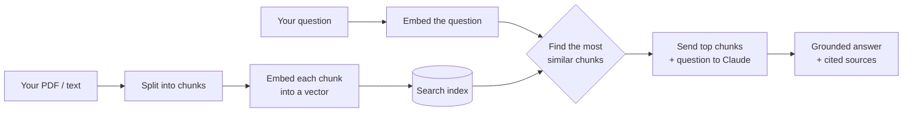

# ragdoc 📄🔍

[](https://github.com/civang/ragdoc/actions/workflows/tests.yml)

**Chat with your documents.** Ask questions about a PDF or text file and get answers grounded in its actual contents — with the source passages shown so you can verify every answer.

Built from scratch to learn how **RAG (Retrieval-Augmented Generation)** — the technique behind "chat with your docs" products — actually works under the hood. No LangChain, no vector-DB service, no frameworks hiding the magic: every piece (chunking, embeddings, semantic search, retrieval, evaluation) is plain, readable Python.

Works in the terminal or the browser, over a single file or a whole folder, and ships with a retrieval eval suite that runs in CI.

---

## What it looks like

```
$ py ask.py handbook.pdf

Building search index for: handbook.pdf
Indexed 214 chunks. Ask away! Type 'exit' to quit.

You: How many vacation days do new employees get?

ragdoc: New employees receive 15 paid vacation days in their first year,
increasing to 20 days after two years of service (Chunk 2).

  Sources (retrieved passages):
    [Chunk 2 | handbook.pdf | similarity 0.612] Full-time employees accrue 15 days
    of paid vacation in year one. After two years of service this increases...
    [Chunk 7 | handbook.pdf | similarity 0.341] Time-off requests must be...

You: and how do I request them?

ragdoc: Requests go through the HR portal at least two weeks in advance
and need manager approval (Chunk 7).
```

Two things to notice:

- Every answer comes with **receipts** — the exact passages it was based on.
- The follow-up **"and how do I request them?"** works. It has no subject of its
  own, but the conversation carries it forward.

---

## How it works

RAG solves a simple problem: language models don't know the contents of *your* documents, and you can't paste a 500-page manual into every question. So instead of sending the whole document, ragdoc finds just the few passages relevant to your question and sends those.



1. **Chunk** — split the document into overlapping passages, on sentence boundaries (`chunk.py`)
2. **Embed** — turn each chunk into a vector that captures its *meaning* (`embed.py`)
3. **Search** — embed the question and find the closest chunks by cosine similarity (`search.py`)
4. **Answer** — send only those chunks to Claude, which answers and cites them (`ask.py`)

### Follow-up questions

A question like *"and where is it?"* carries no subject, so embedding it alone
retrieves noise. ragdoc prepends the previous question before embedding, which
carries the subject forward. On a test corpus that took *"Where is it?"* from
**0.224 → 0.705** similarity against the correct chunk.

The conversation is also passed to Claude, so the model can resolve references
to earlier answers. History is capped to recent turns to bound prompt size.

---

## Quick start

```bash
# 1. Install dependencies
py -m pip install -r requirements.txt

# 2. Set your Anthropic API key (get one at console.anthropic.com)
$env:ANTHROPIC_API_KEY = "sk-ant-your-key-here"     # Windows (PowerShell)
export ANTHROPIC_API_KEY="sk-ant-your-key-here"     # macOS / Linux

# 3. Chat with a document...
py ask.py path/to/your/document.pdf

# ...or with a whole folder of them at once
py ask.py path/to/your/docs/
```

> **macOS / Linux:** the commands use the Windows `py` launcher. Replace `py`
> with `python3` (e.g. `python3 ask.py path/to/your/docs/`).

Supports `.pdf`, `.docx`, `.txt`, and `.md`. Type `exit` to quit.

Point it at a folder and every supported file is indexed into one searchable
collection — ask a question and ragdoc finds the right passage *and tells you
which document it came from*.

### Prefer a browser?

```bash
py web.py path/to/your/docs/
```

Then open **http://localhost:5000** — same pipeline, same cited sources, in a
clean chat UI that adapts to light and dark mode. Answers **stream in
token-by-token**, and the sources appear immediately (retrieval finishes long
before the model does).

### Prefer Docker?

```bash
docker build -t ragdoc .
docker run --rm -p 5000:5000 -e ANTHROPIC_API_KEY -v "$PWD/docs:/docs" ragdoc
```

Mount the folder you want to chat with at `/docs`, then open
**http://localhost:5000**. The embedding model is baked into the image, so the
container starts instantly and needs no download.

> **Tip:** To test cheaply while experimenting, set `MODEL = "claude-haiku-4-5"` in `ask.py`.

The embedding model runs **locally** (via [model2vec](https://github.com/MinishLab/model2vec)) — no second API key, and it works offline after a one-time ~30 MB download.

---

## Project structure

Each file is one step of the pipeline and can be run on its own to see what it does:

| File | What it does | Run it standalone |
|------|-------------|-------------------|
| `chunk.py` | Split a document into overlapping chunks | `py chunk.py <file>` |
| `embed.py` | Turn chunks into meaning-vectors | `py embed.py <file>` |
| `search.py` | Find the chunks most relevant to a question | `py search.py <file>` |
| `ask.py` | **The full RAG app** — retrieve, answer, cite | `py ask.py <file>` |
| `ragdoc.py` | Day-1 baseline: sends the *whole* doc each time | `py ragdoc.py <file>` |
| `evals.py` | Measure retrieval quality (answer recall, Hit@1, MRR) | `py evals.py` |
| `sweep.py` | Sweep chunk size / overlap / top_k against the evals | `py sweep.py` |
| `web.py` | Browser UI for the same pipeline | `py web.py <file-or-folder>` |
| `tests/` | Unit tests for chunking, embeddings, retrieval | `py -m pytest` |

`ask.py` vs `ragdoc.py` is a nice before/after: the baseline sends the entire document every time (simple, but doesn't scale); the real app sends only what's relevant (cheap, fast, works on huge docs).

---

## Built one step at a time

The core was built in seven focused steps, then extended:

| # | Step | Skill |
|---|------|-------|
| 1 | Chat with a whole document | LLM + prompting |
| 2 | Split documents into overlapping chunks | text chunking |
| 3 | Embed chunks into vectors | embeddings |
| 4 | Semantic search over chunks | similarity search |
| 5 | Retrieve-then-answer (real RAG) | retrieval |
| 6 | Show the source behind every answer | grounding / citations |
| 7 | Polish, document, ship | 🎉 |

**Then, beyond the core:**

| Step | Skill |
|------|-------|
| Cache the index to disk (~150× faster restarts) | performance |
| Index a whole folder, with per-file attribution | multi-document RAG |
| Retrieval eval suite (answer recall, Hit@1, MRR) | measurement |
| CI that gates merges on retrieval quality | testing / DevOps |
| Browser UI | full-stack |
| Sentence-aware chunking | retrieval quality |
| pytest suite (42 tests) run in CI | testing |
| Conversational follow-up questions | multi-turn RAG |
| Token-by-token streaming over SSE | real-time UX |
| Parameter sweep to tune chunking from evidence | eval-driven development |

See the [commit history](../../commits) — each step is one focused commit.

---

## Evaluation

"It seems to work" isn't a metric. `evals.py` runs 21 questions against a
corpus of five multi-page documents in `eval_corpus/`, so changes to chunking,
the embedding model, or `top_k` can be judged by a number instead of a vibe.

```bash
py evals.py
```

```
RESULTS  (chunk_size=800, overlap=100, top_k=3, 20 chunks)
  Answer recall : 100%   (answer text present in retrieved chunks)
  Hit@1         :  95%   (correct doc ranked first)
  Hit@3         : 100%   (correct doc retrieved at all)
  MRR           : 0.976  (1.0 is perfect)

  Gate: answer recall >= 75% ... PASS (100%)
  Gate: Hit@1 >= 70% ... PASS (95%)
```

**Answer recall is the metric that matters.** Each test case names a phrase
that must appear in the retrieved chunks — if the answer text never reaches
the model, no prompt can rescue it. Document-level metrics can look healthy
while recall quietly degrades (see the sweep below), which is why it leads.

The questions deliberately avoid the wording of the source — *"Why did my
bread come out heavy and tight?"* has to find a passage about bulk
fermentation — so keyword matching fails them and only meaning-based
retrieval passes.

It exits non-zero if either gate fails, and **runs automatically in CI on
every push** — so a change that quietly degrades retrieval can't slip through.
No API key needed; the evals test retrieval, not generation.

### Tuning by measurement, not intuition

`chunk_size`, `overlap` and `top_k` started as guesses. `sweep.py` runs the
eval suite across a grid of settings so they can be chosen from evidence:

```bash
py sweep.py            # chunk_size x overlap
py sweep.py --top-k    # top_k
```

```
 chunk  overlap  chunks   recall   Hit@1     MRR  ctx chars
   300        0      51     81%     95%   0.976        900
   500        0      28     95%     90%   0.929      1,500
   800      100      20    100%     95%   0.976      2,400   <- default
  1200      200      14    100%    100%   1.000      3,600
  1600      100      10    100%     95%   0.968      4,800
```

What this actually showed:

- **Small chunks quietly lose answers.** At `chunk_size=300`, answer recall
  drops to **81%** — roughly one question in five becomes unanswerable because
  the relevant passage got split across a boundary. Notably, `Hit@1` stays at
  95%, so document-level metrics look fine while the system silently gets
  worse. This is exactly why answer recall is the headline metric.
- **The existing defaults were already the sweet spot.** `chunk_size=800,
  overlap=100` is the cheapest setting reaching 100% recall. Bigger chunks buy
  nothing but cost more context.
- **`top_k=1` is too aggressive** (76% recall); 2 and above hold at 100%. The
  default of 3 is kept as a safety margin, since 21 test cases isn't enough
  evidence to shave it to 2.

The honest outcome of this experiment was *"the defaults are right"* — but
that's now a measured claim rather than a guess, and the sweep is there to
re-run whenever the chunker or embedding model changes.

### Unit tests

Alongside the evals, a pytest suite locks in the guarantees the pipeline
depends on — no text is dropped when chunking, `chunk_size` is never exceeded,
chunks start and end on sentence boundaries, and retrieval returns results in
descending score order.

```bash
py -m pip install -r requirements-dev.txt
py -m pytest
```

Both the unit tests and the evals run in CI on every push.

---

## Concepts demonstrated

- **Retrieval-Augmented Generation** end to end, with no black-box framework
- **Text chunking** with overlap to keep ideas intact across boundaries
- **Embeddings** and **cosine similarity** for meaning-based search
- **Grounding & citations** so answers are verifiable, not hallucinated
- **Prompt design** that constrains the model to answer only from provided context
- **Evaluation** with real retrieval metrics (Hit@1, Hit@3, MRR) and a CI regression gate
- **Caching** to make repeat runs ~150× faster
- **Multi-turn conversation** with history-aware retrieval for follow-up questions
- **Streaming** over Server-Sent Events, with untrusted client input validated server-side

---

## Ideas for going further

- ✅ **Cache the index to disk** so large PDFs don't re-embed on every launch — *done: ~150× faster startup on repeat runs*
- ✅ **Support a whole folder of documents at once** — *done: `py ask.py ./docs/`, with per-file source attribution*
- ✅ **A small web UI** — *done: `py web.py ./docs/` → http://localhost:5000*
- ✅ **Evals to measure accuracy** — *done: Hit@1 / Hit@3 / MRR, gated in CI*
- ✅ **Stream answers token-by-token in the web UI** — *done: SSE, sources render first*
- ✅ **Conversational follow-up questions** — *done: history-aware retrieval + generation*
- ✅ **Sentence-aware chunking** — *done: no more mid-word slicing*
- Swap the local embedder for a hosted one (Voyage, OpenAI) and compare eval scores
- Rerank: retrieve 20 chunks, then re-score them with a cross-encoder
- Deploy it somewhere public (Render, Fly.io, a small VPS)

---

## License

MIT — see [LICENSE](LICENSE).
